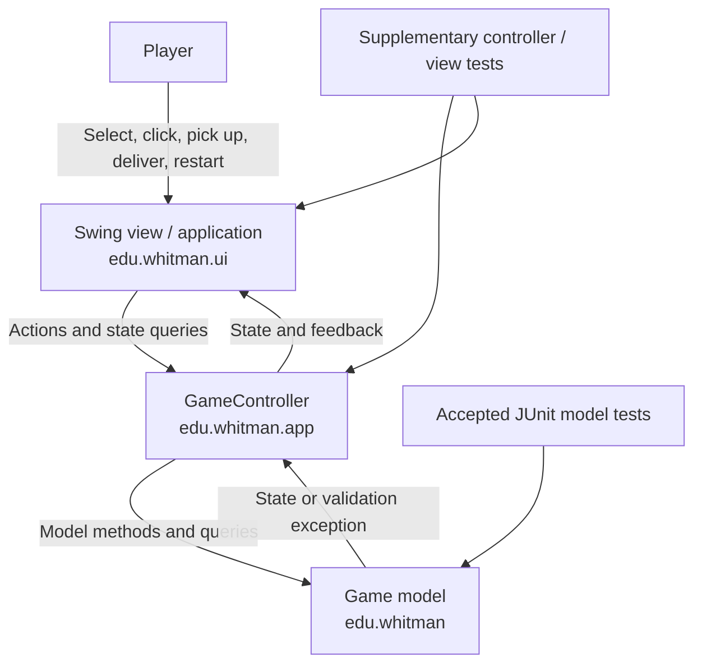
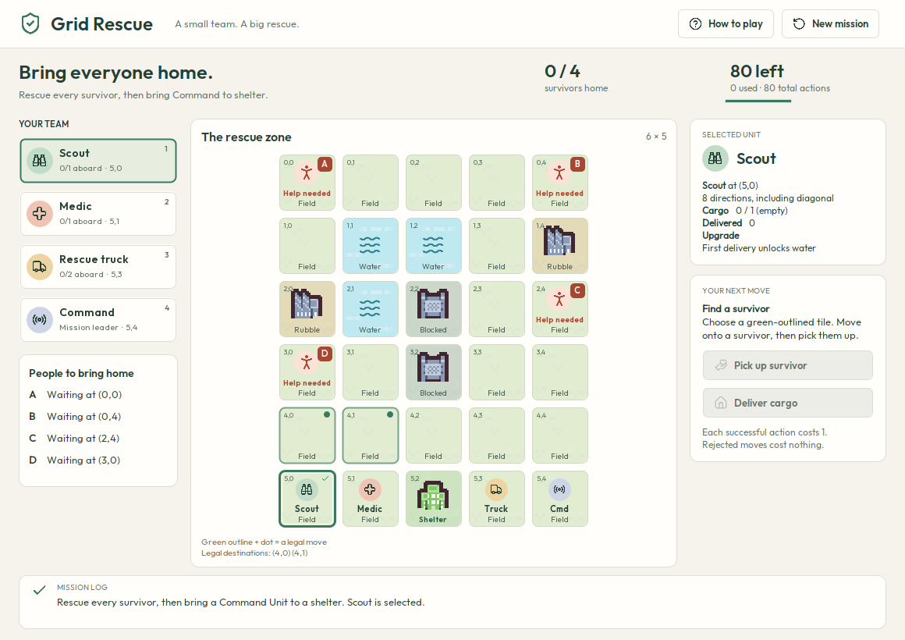
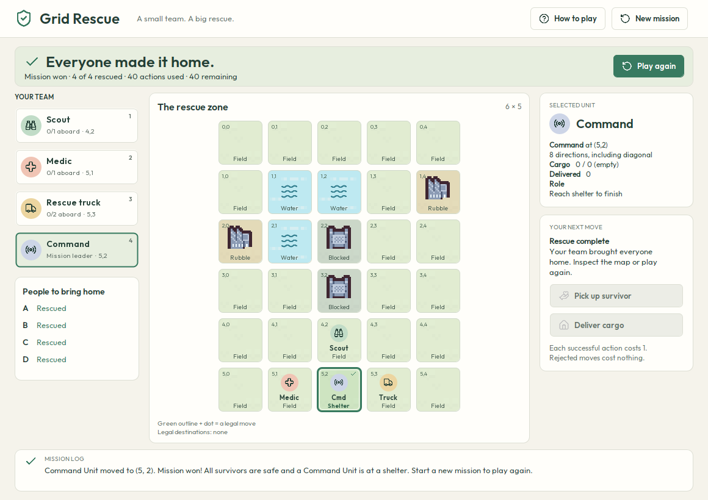

# Grid Rescue

## Introduction

Grid Rescue is a deterministic, single-player rescue puzzle implemented in Java.
Guide a Scout, Medic, RescueTruck, and CommandUnit across a six-row, five-column
map. Rescue all four survivors and bring the CommandUnit to the shelter within
the team's shared budget of 80 actions. Each successful move, pickup, or delivery
costs one action; selecting a unit, inspecting the board, and rejected actions
cost nothing.

Milestone 3 adds a playable Swing desktop interface to the Milestone 2 model.
The interface uses a compact rescue squad, illustrated square map tiles, and a
selected-unit panel to keep the next decision clear. Terrain, units, survivors,
legal moves, cargo, upgrades, and mission progress all remain visible. The
existing model remains the authority for all game rules.

Map sprites and interface icons are bundled locally; see the
[art credits and licenses](docs/Art_Credits.txt).

Repository: [VasylShevtsov/grid-rescue](https://github.com/VasylShevtsov/grid-rescue).

### Build, test, and launch

Use a JDK supporting Java 11 or newer and Maven. From the repository root:

```sh
mvn clean verify
java -jar target/grid-rescue-1.0-SNAPSHOT.jar
```

Alternatively, compile and run the tests, then launch directly from the classes:

```sh
mvn test
java -cp target/classes edu.whitman.ui.GridRescueApplication
```

The app uses Swing, which is included with Java; it has no external runtime
dependencies. A graphical desktop is required to show the window. Maven may
download build plugins and JUnit on the first build. Model and controller tests
can run without opening a window.

### How to play

1. Select a unit in the squad, click its occupied map tile, or press **1–4**.
   Inspect its cargo, capacity, delivered count, upgrade state, and legal moves.
2. Click a board tile to move the selected unit one cell. Coordinates are
   **(row, column)**, starting at **(0,0)** in the upper-left corner.
3. Move onto a waiting survivor, then use **Pick up survivor** or press **P**. Arrival
   alone does not collect a survivor. The action is enabled when pickup is ready.
4. Move to the shelter at **(5,2)**, then use **Deliver cargo** or press **D**. The
   entire cargo is rescued in one action. Move away afterward to let another
   unit enter. The selected-unit panel explains the next useful step.
5. Rescue everyone and move the CommandUnit onto the shelter to win. The mission
   is lost if the action budget runs out first. A win on the final action counts.
6. Use **How to play** or **H** for the rules; **Escape** returns to the mission.
   Starting over after playing asks for confirmation so progress is not
   discarded accidentally. The outcome summary offers **Play again**.

Use **Tab** to reach controls and map tiles. Arrow keys move focus around the
map without spending actions; **Enter** or **Space** activates the focused tile.
A visible focus ring distinguishes keyboard focus from the selected unit.

| Unit | Movement | Terrain | Capacity | First personal delivery |
| --- | --- | --- | --- | --- |
| Scout | Eight neighboring cells | Plain, shelter, rubble | 1 | Also permits water |
| Medic | Four orthogonal neighbors | Plain, shelter | 1, then 2 | Increases capacity to 2 |
| RescueTruck | Four orthogonal neighbors | Plain, shelter | 2 | No upgrade |
| CommandUnit | Eight neighboring cells | Plain, shelter | 0 | Cannot carry survivors |

The map labels plain terrain **Field**. No unit can enter blocked terrain or
another unit's cell. A waiting survivor does
not block movement. A failed action shows a message and leaves the game unchanged.
After a win or loss, actions are locked; the outcome remains visible and a new
mission can be started.

## Functional requirements

The identifiers below follow the Milestone 3 catalogue. FR01–FR26 describe the
reused model; FR27–FR32 describe the added interface. Named suites are executable
evidence in `src/test/java/edu/whitman/`; the demo covers visible interaction.

1. **FR01 — Default scenario.** Create the specified 6 × 5 terrain layout, four
   units, survivors A–D, shelter, and 80-action budget. Evidence: `GameTest`.
2. **FR02 — Team ownership.** Maintain one named rescue team, its registered
   units, and its rescued-survivor list. Evidence: `TeamTest`.
3. **FR03 — Survivor registry.** Retain every registered survivor whether waiting,
   carried, or rescued. Evidence: `TeamTest`, `TileTest`.
4. **FR04 — Flexible action order.** Allow any team unit to act on successive
   actions, including repeated actions by the same unit. Evidence: `GameTest`.
5. **FR05 — Legal destinations.** Return every legal neighboring destination once,
   using the game's canonical tiles. Evidence: unit-specific test suites.
6. **FR06 — Eight-direction movement.** Let Scout and CommandUnit move to legal
   orthogonal or diagonal neighbors. Evidence: `ScoutTest`, `CommandTest`.
7. **FR07 — Four-direction movement.** Restrict Medic and RescueTruck to legal
   orthogonal neighbors. Evidence: `MedicTest`, `TruckTest`.
8. **FR08 — Terrain permissions.** Enforce each unit's terrain permissions and
   prohibit every unit from blocked terrain. Evidence: unit-specific test suites.
9. **FR09 — Invalid destinations.** Reject occupied, foreign, counterfeit,
   stationary, and nonadjacent destinations. Evidence: `UnitTest`.
10. **FR10 — Independent occupancy.** Permit a unit and waiting survivor to share
    a tile without automatic pickup. Evidence: `TileTest`.
11. **FR11 — Explicit pickup.** Pick up only a registered waiting survivor on the
    selected unit's tile when capacity remains. Evidence: `UnitTest`, `TileTest`.
12. **FR12 — Capacity.** Maintain Scout capacity 1, Truck capacity 2, Command
    capacity 0, and Medic capacity 1 or 2 according to its upgrade.
    Evidence: unit-specific test suites.
13. **FR13 — Batch delivery.** Deliver all carried survivors at a shelter in one
    action and return the batch size. Evidence: `UnitTest`, `TruckTest`.
14. **FR14 — Permanent rescue.** Mark delivered survivors rescued, clear their
    tile and carrier references, and remove them from cargo. Evidence: `TileTest`.
15. **FR15 — Personal totals.** Track each unit's personal delivered count.
    Evidence: `UnitTest`, `TeamTest`.
16. **FR16 — Scout upgrade.** Permanently allow Scout to enter water after its
    first personal delivery. Evidence: `ScoutTest`.
17. **FR17 — Medic upgrade.** Permanently raise Medic's capacity to 2 after its
    first personal delivery. Evidence: `MedicTest`.
18. **FR18 — Action accounting.** Charge exactly one shared action for each
    successful move, pickup, or delivery. Evidence: `GameTest`.
19. **FR19 — Rejection atomicity.** Preserve all observable model state and charge
    no action for rejected operations. Evidence: `TestSupport` snapshot assertions
    used throughout the accepted suites.
20. **FR20 — Victory.** Win when at least one survivor is registered, every
    registered survivor is rescued, and a CommandUnit occupies a shelter.
    Evidence: `GameTest`, `CommandTest`.
21. **FR21 — Last-action priority.** Award victory before checking budget
    exhaustion after a successful action. Evidence: `GameTest`.
22. **FR22 — Defeat.** Lose when the budget is exhausted without meeting the
    victory conditions. Evidence: `GameTest`, `CommandTest`.
23. **FR23 — Terminal lock.** Reject move, pickup, and delivery after a win or
    loss while preserving read-only queries and returning no legal moves.
    Evidence: `GameTest`.
24. **FR24 — Custom model fixtures.** Support empty custom 6 × 5 boards with
    valid terrain, at least one shelter, and a positive action limit through the
    model API. The desktop starts the default mission. Evidence: `GameTest`.
25. **FR25 — Setup lifecycle.** Allow unit/survivor registration only before the
    first successful action; prevent reuse of an already bound team.
    Evidence: `GameTest`, `TeamTest`.
26. **FR26 — Names and IDs.** Trim and validate nonblank team names and survivor
    IDs, and enforce survivor-ID uniqueness throughout the game registry.
    Evidence: `TeamTest`, `TileTest`.
27. **FR27 — Visible map.** Show terrain, coordinates, units, waiting survivors,
    and shelters with labels as well as illustrated tiles. Evidence: Swing view and
    [starting screenshot](docs/screenshots/mission-start.png).
28. **FR28 — Selection and inspection.** Let the player select a unit and inspect
    legal destinations, cargo, capacity, delivery count, and upgrade state. Support
    squad buttons, occupied-tile selection, and number keys. Evidence:
    controller/view tests and [demo walkthrough](docs/Milestone_3_Demo.txt).
29. **FR29 — Playable controls.** Provide board-click movement, pickup, delivery,
    and useful invalid-action messages. Disable pickup/delivery until applicable
    and explain the next step. Evidence: controller/view tests and demo.
30. **FR30 — Mission feedback.** Display actions used/remaining, rescued count,
    and current or final mission status. Evidence: controller/view tests and
    [completed screenshot](docs/screenshots/mission-won.png).
31. **FR31 — Fresh missions.** Start a fresh default mission with a new team and
    game, resetting selections and visible progress. Confirm restarting a mission
    with progress; cancellation preserves it. Evidence: controller/view tests
    and demo restart check.
32. **FR32 — In-app help.** Present the objective, controls, movement, terrain,
    capacity, upgrades, and victory/loss rules through an in-app Help screen.
    Evidence: Swing view tests and demo help check.

## Nonfunctional requirements

| ID | Requirement and measurable acceptance check |
| --- | --- |
| NFR01 — Reproducibility | Compile for Java 11 and run the accepted 53 model tests plus supplementary suites with `mvn clean verify`. The documented JAR command launches the desktop. Model actions perform no file or network operations. |
| NFR02 — Modularity | Keep all Swing classes in `edu.whitman.ui` and coordination in `edu.whitman.app`; model classes in `edu.whitman` import neither package nor Swing. Model/controller tests run without a window. Inspect package imports and run the tests. |
| NFR03 — State integrity | Return defensive public collection snapshots and copy both board-array levels; rejected operations change no observable state. Verify with the accepted defensive-copy and before/after snapshot tests. |
| NFR04 — Usability | Identify terrain, selection, legal moves, cargo, budget, and final outcome in text as well as color. Complete the demo's successful move, rejected action, delivery/upgrade, win, and fresh-mission checks without restarting the application. |
| NFR05 — Maintainability | Keep game validation in the model, centralize action coordination in the controller, and keep rendering/input in the view. Include launch instructions, a component diagram, a documented demo, and separate supplementary tests; review that a rule change does not require a second rule implementation in the UI. |

## Architecture choice, justification, and a simple component diagram

The app uses a layered Model–View–Controller architecture. A desktop interface
fits a small, local puzzle: Swing provides the board and controls without a
server, browser, or extra runtime libraries.

- **Model — `edu.whitman`:** `RescueGame`, `RescueTeam`, `RescueUnit` and its
  subclasses, `Tile`, and `Survivor` own state, validation, legal moves, upgrades,
  and mission evaluation. They contain no presentation or input/output code.
- **Controller — `edu.whitman.app.GameController`:** manages selection, delegates
  requested actions to the model, translates expected exceptions into player
  feedback, and constructs a new team/game for restart.
- **View and entry point — `edu.whitman.ui`:** `GridRescueApplication` launches
  Swing on its event-dispatch thread. The view renders the board and state and
  forwards user input to the controller.

This separation preserves the Milestone 2 public model API and its accepted
tests. The UI uses model queries for valid destinations and delegates state
changes to model methods, so a display update cannot introduce a conflicting
set of game rules. The controller can be exercised without a desktop window.
The existing [UML class diagram](docs/Grid%20Rescue%20UML%20Diagram.pdf) describes
the model; this component diagram shows the full application's boundaries.



### Repository structure and verification

| Location | Responsibility |
| --- | --- |
| `src/main/java/edu/whitman/` | Milestone 2 model and unit inheritance |
| `src/main/java/edu/whitman/app/` | Selection, action coordination, feedback, restart |
| `src/main/java/edu/whitman/ui/` | Desktop entry point, Swing board and controls |
| `src/test/java/edu/whitman/` | Accepted model suites and separate supplementary tests |
| `.github/workflows/ci.yml` | Existing CI/grading workflow |
| `tools/grade.py` | Accepted 53-test model grade calculation |
| `tools/capture-screenshots.sh` | Reproduce documented states from the real Swing view |
| `docs/` | Assignment sources, UML, screenshots, and demo |

Verified on **Java 11 (Eclipse Temurin 11.0.32.1)**: `mvn clean verify` passes
**92 tests**, with no failures, errors, or skips. These comprise 53 accepted
model tests, 3 model-contract tests, 16 controller tests, and 20 Swing view and
player-journey tests. The accepted grading denominator remains 53. Maven writes current results to `target/surefire-reports/`; the
[Milestone 3 verification report](docs/Milestone_3_Verification.txt) records the
final build, test totals, launch, and interface evidence.

The supplementary tests exercise the complete 40-action route, rejected actions,
cargo and upgrades, input controls, help, restart confirmation/cancellation,
terminal behavior, and layout at multiple sizes. Follow the
[demo walkthrough](docs/Milestone_3_Demo.txt) to rehearse the visible interactions.
The [UI design review](docs/UI_Design_Review.txt) explains the visual and interaction
changes and the evidence used to check them.

This work is on **`Project-Milestone-3`**, created from `main`; the earlier
Milestone 3 implementation is included on this branch. No Milestone 3 commits
were added to `Project-Milestone-2`.

Before hand-in, place the final version on `main` in the instructor-designated
repository and add the Google presentation URL below.

## Demo link or screenshot

Fresh default mission:



Completed mission:



These images are rendered from the real Swing view after exercising its actual
buttons without opening a desktop window. The default mission was completed in
40 actions. Additional evidence:

| Image | Captured state |
| --- | --- |
| [Rejected action](docs/screenshots/action-rejected.png) | An invalid destination shows feedback without spending an action. |
| [Scout upgraded](docs/screenshots/scout-upgraded.png) | D delivered at action 6; Scout gains water access and 74 actions remain. |
| [Low action budget](docs/screenshots/mission-low-budget.png) / [mission lost](docs/screenshots/mission-lost.png) | One action remains, then the default mission ends after 80 moves without rescues. |
| [Survivor reached](docs/screenshots/survivor-reached.png) | D is waiting on Scout's tile; pickup is now available. |
| [Survivor aboard](docs/screenshots/survivor-aboard.png) | Cargo and registry show D aboard Scout; guidance points to shelter. |
| [Restart confirmation](docs/screenshots/restart-confirmation.png) | Preserve the active mission with Keep playing, or start over. |
| [How to play](docs/screenshots/how-to-play.png) / [scrolled rules](docs/screenshots/how-to-play-rules.png) | In-window instructions; the final rules remain reachable by scrolling. |
| [Compact mission](docs/screenshots/mission-compact.png) / [compact help](docs/screenshots/how-to-play-compact.png) | Layout at the smallest directly supported view size. |
| [Large mission](docs/screenshots/mission-large.png) | The board keeps square tiles as the window grows. |

Reproduce the screenshots from the repository root:

```sh
sh tools/capture-screenshots.sh
```

[Demo and verification walkthrough](docs/Milestone_3_Demo.txt) includes the
40-action winning route, intermediate states, a rejected action, terminal
behavior, restart, and an optional loss check on the default mission.

## Link to the Google presentation

Google Slides URL: **https://docs.google.com/presentation/d/1ek-hJFFFrsD2LNUn3aIAJpVxrTUylpB-lU-ENLQ_XI8/edit?usp=sharing**


## AI assistance

AI assisted with the Swing interface and its visual redesign, controller,
supplementary tests, and Milestone 3 documentation. The work was checked against the supplied game rules
and existing public API, the accepted and supplementary tests, and rendered
views produced through real button interactions. The existing model remains
the source of game rules and validation.
